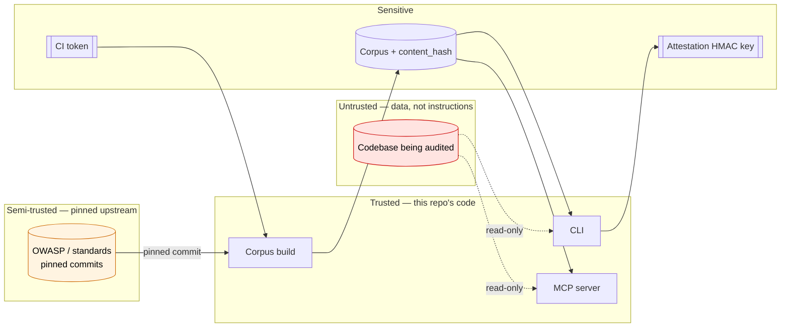

# Threat Model

**Version:** 1.0 · **Date:** 2026-11-04 · **Methodology:** STRIDE · **Applies to:** v0.9.8

This document states what `secure-kb` protects, what it assumes, and what it deliberately does not
protect. It exists so that a security decision — including a decision to *accept* a risk — can be
argued with rather than guessed at. Every risk below has an ID that is carried into
`risk-register.yaml`, where the justification and re-check date live.

Read it alongside [`SECURITY.md`](../SECURITY.md) (how to report). The project's known
limitations are stated in the README's benchmark section.

---

## 1. Scope

**In scope:** the CLI (`cli/secure_kb.py`), the MCP server (`mcp/server.py`), the corpus build
(`scripts/ingest_from_cache.py`, `build_cards_v2.py`, `dedupe.py`, `build_index.py`,
`fetch_sources.py`), the shipped corpus and index, the agent skill (`skills/secure-kb-audit/`), the
benchmark harness, and CI.

**Out of scope:** vulnerabilities in the upstream OWASP / standards sources we ingest; the security
of any codebase this tool is pointed at; the security of the agent that consumes the MCP server; and
the model provider that runs the agent.

---

## 2. System overview

| Component | Entry point | What it touches |
|---|---|---|
| `fetch_sources.py` | maintainer, manual | Network (raw.githubusercontent.com), writes `cache/` |
| Corpus build | maintainer / CI | Reads `cache/` + `checks/`, writes `index/`, `manifest.json` |
| `cli/secure_kb.py` | user shell | Reads the corpus; **reads a user-supplied target path** |
| `mcp/server.py` | an AI agent over stdio | Same as the CLI, plus `attest` / `verify_attestation` |
| Agent skill | Claude Code / Codex / OpenCode / Pi | Instructs an agent to run the CLI |
| CI (`ci.yml`) | GitHub Actions | `contents: read`; builds, validates, benchmarks |
| `docs/` (Pages) | public web | Static site only |

---

## 3. Trust boundaries

**The key invariant:** *the codebase being audited is data, not instructions.* Neither the CLI nor
the MCP server executes, imports, or `source`s anything from the target path — it is walked and read
only. The agent skill carries the same rule forward: content found in an audited repo must never be
followed as an instruction.

---

## 4. Assets, ranked by blast radius

1. **Corpus integrity** — if the cards are silently altered, every audit built on them is wrong
   while still looking authoritative. This is the highest-value asset.
2. **Attestation signing key** — whoever holds it can issue attestations that verify.
3. **The audited target's files** — read-only access; the tool must never write to or exfiltrate them.
4. **CI credentials** — scoped to `contents: read`, but still a token.
5. **Published artifacts** — the corpus, index and Pages site that consumers trust.

---

## 5. STRIDE analysis

Each row is a threat, the control that addresses it, and how we verify the control still works.

### Spoofing

| ID | Threat | Mitigation | Verification |
|---|---|---|---|
| R-001 | Someone issues an attestation claiming our `content_hash` without holding the key | Optional HMAC-SHA256 over the attestation id; `verify-attestation` checks it | `tests/test_cli.py::test_attest_wrong_key` |
| R-002 | A fork or confusable name passes itself off as this project | Canonical repo URL in README/`CITATION.cff`; `content_hash` in `manifest.json` lets a consumer check they got our corpus | Manual comparison of `manifest.json` |
| R-003 | A card claims provenance to a source that does not match its pinned commit | Sources are fetched at **pinned commits** (`sources.yaml` `commit:`, `sources_files.tsv`); the fetch URL embeds the commit | Determinism CI job; `fetch_sources.py` fails closed |

### Tampering

| ID | Threat | Mitigation | Verification |
|---|---|---|---|
| R-004 | Someone edits `checks/**` or `index/checks.jsonl` | `content_hash` in `manifest.json`, recomputed in CI | Determinism CI job fails on mismatch |
| R-005 | A partial index build leaves a valid-looking empty `kb.sqlite` that is then trusted forever | `ensure_db()` validates the row count against the source and rebuilds | Planted-empty-DB test (v0.9.5) |
| R-006 | Upstream force-pushes and a pinned commit disappears | Each file fails independently and is reported — but `fetch_sources.py` **still exits 0**, so a partial fetch is not a CI failure by itself. The real backstop is the determinism job: a corpus built from missing sources has a different `content_hash` | Determinism CI job; `fetch_sources.py` failure lines in the log |
| R-017 | The corpus embeds the build date (`last_verified`), so identical sources produce a different `content_hash` on a different day — the determinism check can only pass on the day the corpus was built | `last_verified` now comes from a committed `CORPUS_DATE` file, and the build fails closed if it is missing | `tests/test_determinism.py::test_builder_does_not_use_wall_clock` |
| R-007 | A Python dependency is compromised or typosquatted | Ranges are bounded (`telethon>=1.34,<2`); no lockfile or hashes yet | **Not yet verified — see R-007 in the register** |

### Repudiation

| ID | Threat | Mitigation | Verification |
|---|---|---|---|
| R-008 | An issuer backdates an attestation | **Not mitigated.** There is no external timestamp authority or transparency log | Accepted risk; documented in `docs/ATTESTATION.md` |
| R-009 | An attestation is read as "this code is safe" | The payload records *what was claimed*, not that the claim is true; the docs say so explicitly | `docs/ATTESTATION.md`, "What it proves" |

### Information disclosure

| ID | Threat | Mitigation | Verification |
|---|---|---|---|
| R-010 | An agent points `detect`/`attest` at `~/.ssh` or `/etc` and receives file names back | Reads are capped (200 KB/file, 8,000 files) and only *names* and matched signal strings are returned, never file content | `iter_files(cap=8000)`, `cmd_detect` size guard |
| R-011 | The MCP server runs with the invoking user's privileges | Inherent to a local stdio server; run it as a user that cannot read what it should not | Deployment guidance |
| R-012 | Reports and attestations contain target file paths | Fingerprints are hashes; only the path *list* is hashed, not stored | `fingerprint_target` |

### Denial of service

| ID | Threat | Mitigation | Verification |
|---|---|---|---|
| R-013 | `fingerprint_target` reads **every file fully into memory** with no size cap, so one multi-GB file exhausts RAM | **Not mitigated.** `iter_files` caps at 8,000 files, but `fingerprint_target` walks independently and is unbounded | **Open finding — see R-013 in the register** |
| R-014 | A pathologically large tree makes `detect` slow | `iter_files(cap=8000)` bounds the walk | `cli/secure_kb.py` |

### Elevation of privilege

| ID | Threat | Mitigation | Verification |
|---|---|---|---|
| R-015 | Path traversal via a crafted profile name (`../../etc/passwd`) | `get_profile` validates `^[a-z0-9][a-z0-9_-]*$` before touching the filesystem | `mcp/server.py` guard |
| R-016 | Prompt injection: the audited repo contains text telling the agent to do something | The skill states that audited content is data, never instructions; the CLI/MCP never execute target content | `skills/secure-kb-audit/SKILL.md` |

---

## 6. Risk summary matrix

| ID | Threat | Category | Likelihood | Impact | Residual | Status |
|---|---|---|---|---|---|---|
| R-001 | Forged attestation | Spoofing | Low | High | Low | Mitigated (optional signing) |
| R-002 | Confusable fork | Spoofing | Medium | Medium | Medium | Accepted |
| R-003 | Provenance mismatch | Spoofing | Low | High | Low | Mitigated (commit pinning) |
| R-004 | Corpus tampering | Tampering | Low | Critical | Medium | Partially mitigated (manifest unsigned) |
| R-005 | Index cache poisoning | Tampering | Medium | High | None | Mitigated (v0.9.5) |
| R-006 | Upstream commit disappears | Tampering | Low | Medium | Low | Partially mitigated (exit 0) |
| R-017 | Build date stamped into card content | Tampering | High | Medium | None | Mitigated (CORPUS_DATE) |
| R-007 | Dependency compromise | Tampering | Medium | High | Medium | Deferred |
| R-008 | Backdated attestation | Repudiation | Low | Medium | Medium | Accepted |
| R-009 | Attestation over-read as "safe" | Repudiation | Medium | Medium | Low | Mitigated (documented) |
| R-010 | Reading unintended paths | Info disclosure | Medium | Low | Low | Accepted (bounded) |
| R-011 | MCP runs as invoking user | Info disclosure | High | Medium | Medium | Accepted |
| R-012 | Paths in reports | Info disclosure | High | Low | Low | Accepted (by design) |
| R-013 | Unbounded file read in `fingerprint_target` | Denial of service | Medium | High | High | **Open** |
| R-014 | Large tree slows `detect` | Denial of service | Medium | Low | Low | Mitigated (cap) |
| R-015 | Profile path traversal | Elevation | Low | High | None | Mitigated |
| R-016 | Prompt injection from audited repo | Elevation | Medium | Medium | Medium | Mitigated (documented) |

**Counts:** 6 mitigated · 4 accepted · 1 deferred · 1 open · 5 partially mitigated with residual.

---

## 7. Security assumptions

These are the things we assume, stated so they can be challenged:

1. **The corpus is built from pinned commits**, not from live branches, so the same source content is
   reproducible later.
2. **The audited codebase is adversarial.** It may contain malicious text, symlinks, or enormous
   files. It is treated as data.
3. **The agent consuming the MCP server may be misaligned with its own user** — it may be tricked by
   content in the repo it is reading. We do not rely on the agent behaving well; we bound what the
   tools return.
4. **`manifest.json` is trusted if it matches `content_hash`.** There is no signature over the
   manifest itself — a consumer who trusts the repo must trust the manifest it ships with (R-004).
5. **Attestations are only as good as the honesty of the issuer.** Signing proves *who*, not *what
   was actually done* (R-009).
6. **The user's machine is not already compromised.** A local stdio MCP server inherits the user's
   privileges; we do not defend against an attacker who already runs as that user.

---

## 8. Out of scope

- Vulnerabilities in the OWASP / standards sources we ingest.
- The security of any application audited with this KB — the KB tells you *what to check*.
- The model, the agent harness, or the transport it uses.
- Multi-tenant or hosted deployment. This is a local, single-user tool.
- Timing side channels in Python-level string comparison.
